<p align="center">
  
</p>

<h1 align="center">TALVIS</h1>

<p align="center">
  <strong>The open-source business suite for service teams.</strong><br>
  CRM · Projects · Time tracking · Invoicing · HR · Marketing automation · Uptime monitoring
</p>

<p align="center">
  <a href="https://talvis.org">Website</a> ·
  <a href="https://talvis.org/#demo">Video demo</a> ·
  <a href="#quick-start">Quick start</a> ·
  <a href="https://github.com/at2software/talvis/releases">Releases</a> ·
  <a href="CHANGELOG.md">Changelog</a>
</p>

<p align="center">
  <a href="LICENSE"></a>
  <a href="https://github.com/at2software/talvis/releases"></a>
  <a href="https://github.com/at2software/talvis/stargazers"></a>
  
</p>

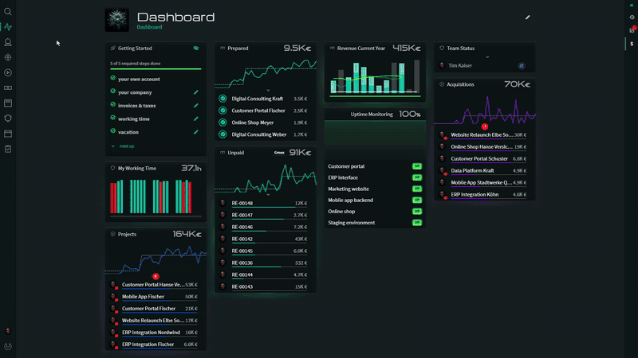

TALVIS replaces the patchwork of CRM, project tool, time tracker, invoicing app and spreadsheet that most agencies, consultancies and IT service companies live with. It is one self-hosted web application with one login and one database — free under the [GNU AGPL v3](LICENSE), with **no per-user pricing, no paid tiers and no feature paywalls**.

- **Your data stays with you.** Self-hosted with Docker; AI features use models you run yourself.
- **Everything is included.** Every module in this repository is part of the free release.
- **Built from daily use.** TALVIS has run [at² GmbH](https://www.at2-software.com) for years before it was open-sourced.
- **Ready in minutes.** One `docker compose up -d`, then a setup wizard.

> Built for digital agencies, IT service companies, consultancies, freelancers and software development teams.

All screenshots and recordings in this README show demo data of a fictional company.

---

## Quick start

You need [Docker](https://docs.docker.com/get-docker/) 24+ with Compose v2 and about 4 GB of RAM.

```bash
# download and extract the latest release from
# https://github.com/at2software/talvis/releases, then:
cp .env.example .env      # set ADMIN_EMAIL, ADMIN_PASSWORD and the database passwords
docker compose up -d
```

Open <http://localhost:3200>, sign in with the admin account from `.env`, and let the setup wizard configure your company, invoicing and working time. The [full installation guide](#running-with-docker) follows below.

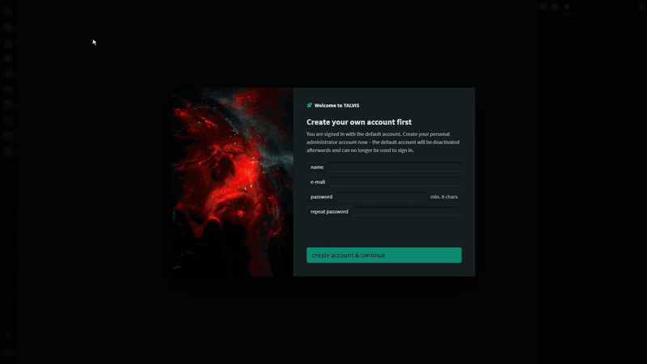

---

## Features

| Module | What it does |
|---|---|
| **CRM** | Company and contact management, relationship mapping, revenue analytics |
| **Projects** | Gantt planning, milestone planner with inbox, team and Outlook/iCal calendars and daily workload, tasks, team assignments, budget tracking |
| **Invoicing** | PDF generation, ZUGFeRD/Factur-X, recurring billing, SEPA direct debit (pain.008), DATEV export, cash flow |
| **Time Tracking** | Focus sessions, break management, workload heatmaps, billable hours |
| **HR** | Vacation, sick leave, travel expenses, team capacity analytics |
| **Marketing** | Prospect pipeline, outreach queue with call, email and LinkedIn touchpoints, campaign management, Sankey funnel charts |
| **AI Insights** | Machine-learning predictions — customer churn, revenue forecasts, project overrun risk |
| **Sentinels** | Visual no-code automation — triggers, conditions, commands |
| **Uptime Monitoring** | HTTP health checks with alerting via email and team chat |
| **Security Audits** | Scheduled re-runs of the dependency, container and SAST scan jobs of each deployed GitLab pipeline, reported to team chat |
| **Project Flow** | Configurable project phases with gates, four-eyes approvals and risk classes; development jobs that AI agents claim through an MCP server |
| **Integrations** | Mattermost, Slack and Microsoft Teams; issues from GitLab, Mantis, Jira and GitHub; Microsoft 365 calendar, contacts and automatic replies; signed outgoing webhooks for n8n, Make or Zapier |
| **Calendar** | CalDAV and CardDAV protocol support for universal device sync, subscribable ICS feed for Outlook and Google Calendar |

---

## Screenshots

<table>
  <tr>
    <td width="50%"><b>Projects</b> — milestone planner and Gantt timeline<br>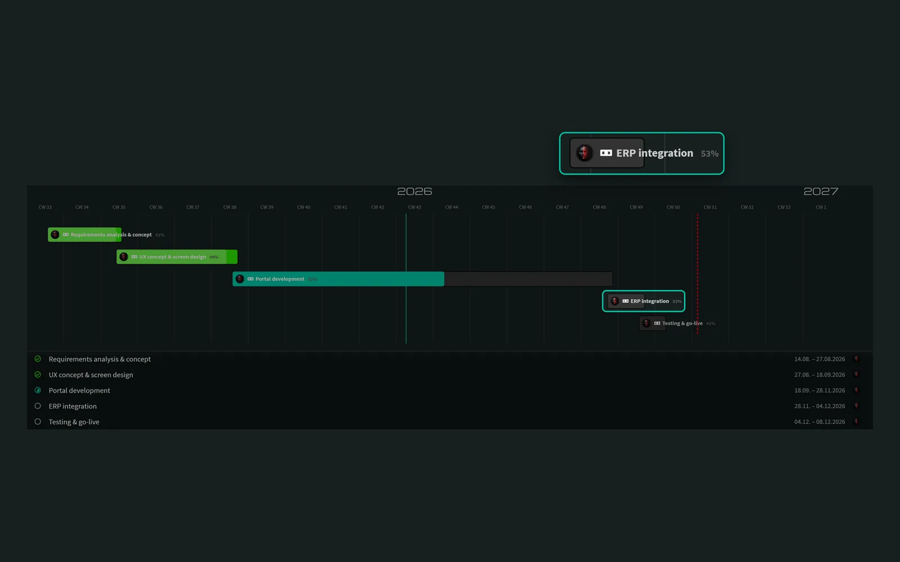</td>
    <td width="50%"><b>Project Flow</b> — phases, jobs and reviews for people and AI agents<br>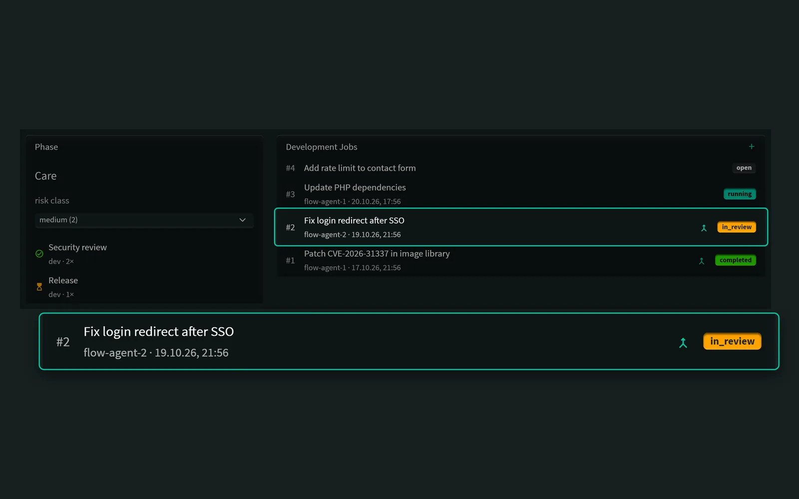</td>
  </tr>
  <tr>
    <td><b>CRM</b> — customer profile with revenue analytics<br>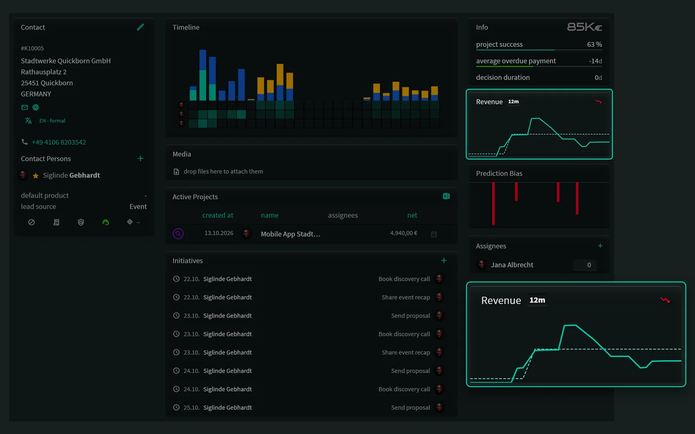</td>
    <td><b>Invoicing</b> — invoice editor with time-based line items<br>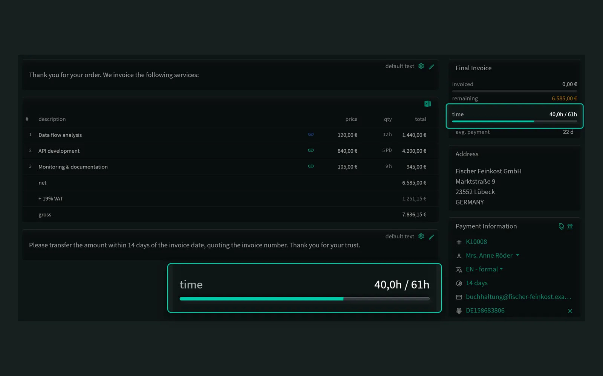</td>
  </tr>
  <tr>
    <td><b>PDF invoices</b> — your letterhead, your language<br>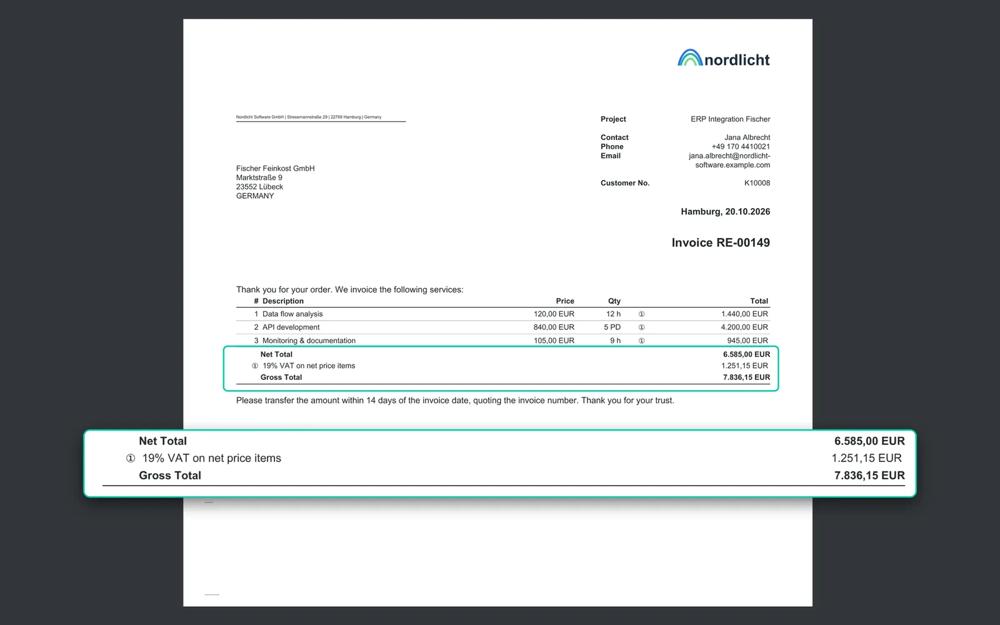</td>
    <td><b>Time Tracking</b> — working time and project focus<br>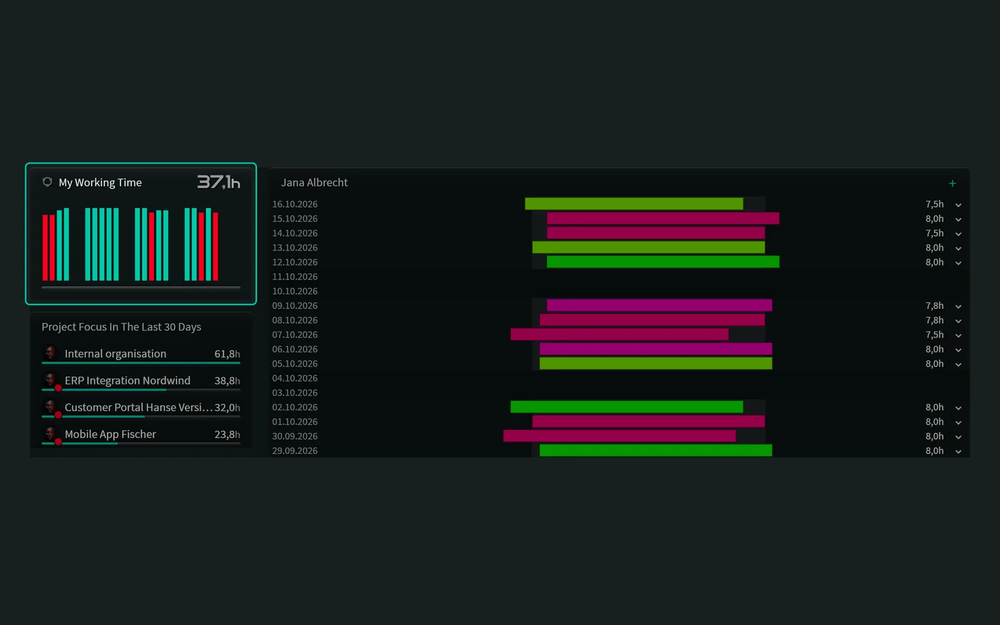</td>
  </tr>
  <tr>
    <td><b>Capacity Planning</b> — workload heatmap per person<br>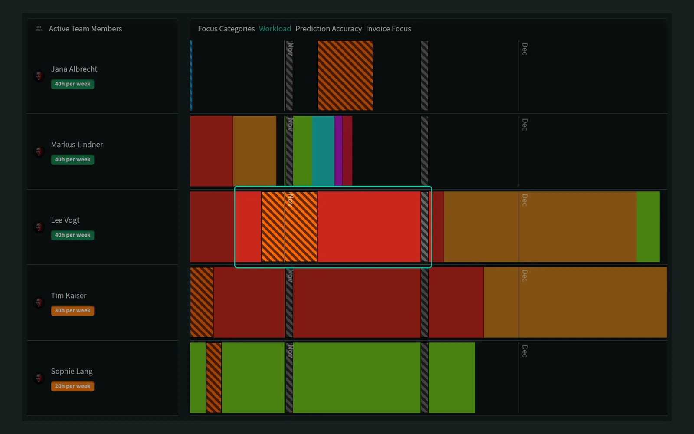</td>
    <td><b>HR</b> — team overview and vacation entitlements<br>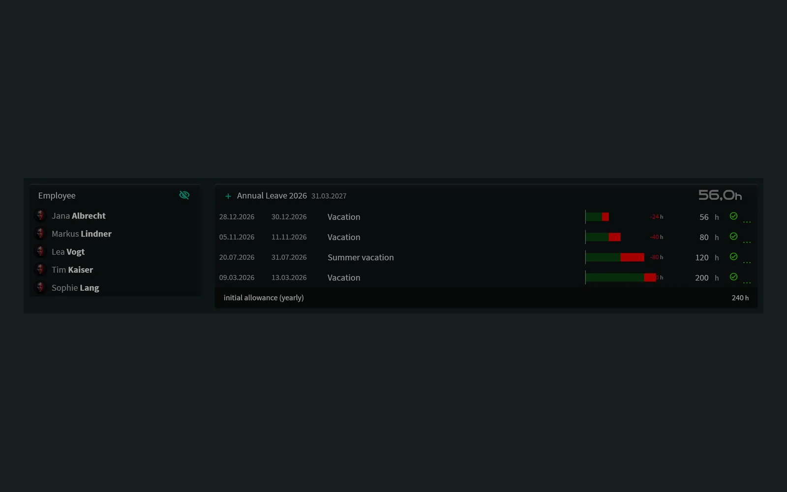</td>
  </tr>
  <tr>
    <td><b>Marketing</b> — prospect funnel (Sankey) and outreach KPIs<br>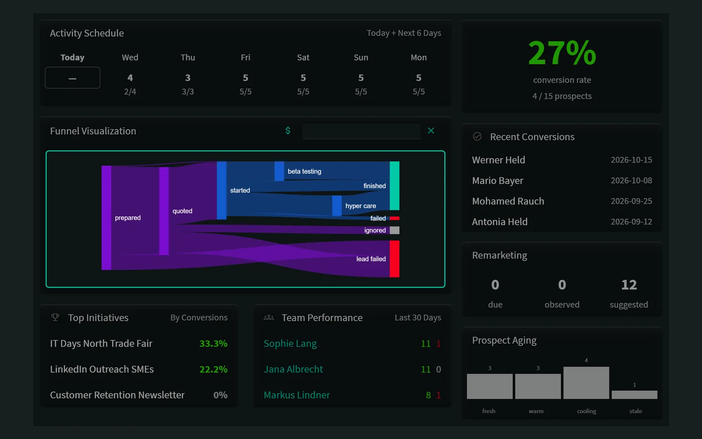</td>
    <td><b>Sentinels</b> — no-code automation: triggers → conditions → actions<br>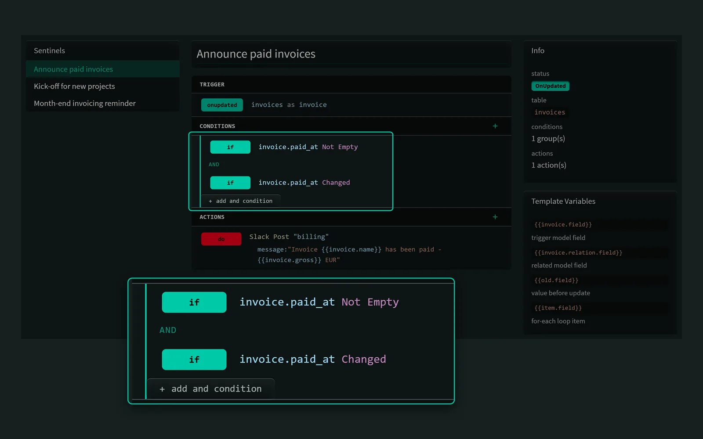</td>
  </tr>
  <tr>
    <td><b>Uptime Monitoring</b> — health checks with history<br>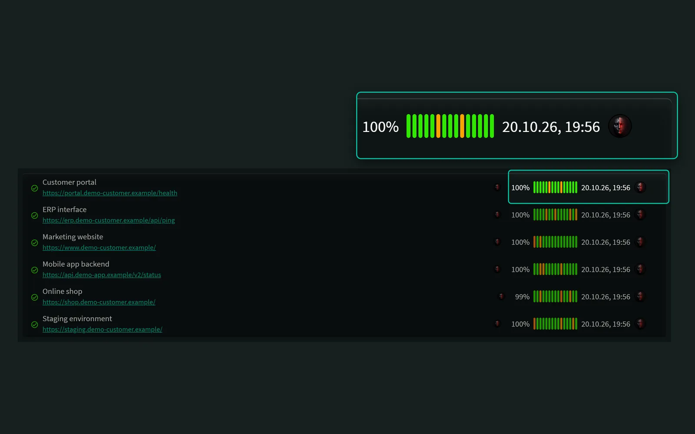</td>
    <td><b>Calendar</b> — CalDAV/CardDAV sync, vacation and team events<br>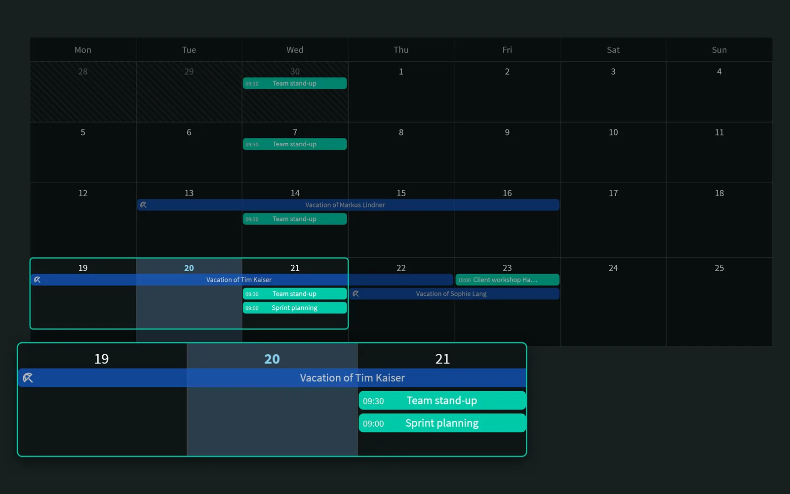</td>
  </tr>
  <tr>
    <td colspan="2"><b>Integrations</b> — GitLab, Mattermost, webhooks and more, configured per connector<br>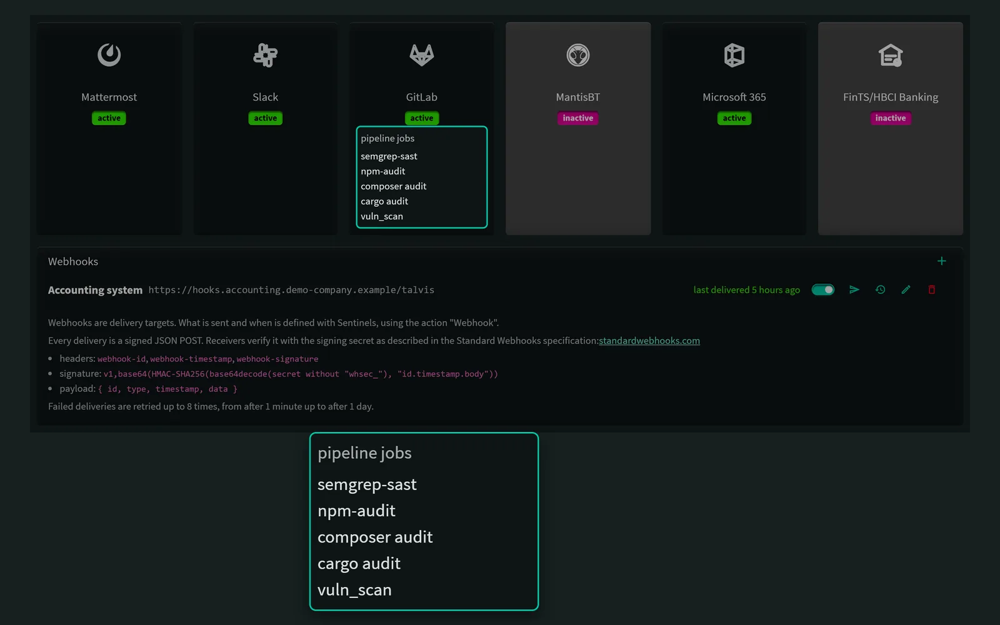</td>
  </tr>
</table>

More recordings: [time to invoice](docs/media/time-to-invoice.gif) · [building a Sentinel](docs/media/sentinel-build.gif) · [setup wizard](docs/media/setup-wizard.gif)

---

## Why TALVIS?

| | TALVIS | Typical alternatives |
|---|---|---|
| Per-user pricing | None | Often per seat |
| Feature paywalls | None — one package | Paid editions or add-ons |
| Hosting | Self-hosted, Docker | Varies |
| Automation | Built-in Sentinels, no code | Separate tools or paid add-on |
| Uptime monitoring | Built in | Separate tool |
| Calendar and contacts | CalDAV / CardDAV | Often missing |

---

## Tech Stack

| Layer | Technology |
|---|---|
| Frontend | Angular 22, TypeScript, Bootstrap 5, RxJS |
| Backend | Laravel 13, PHP 8.4, Eloquent ORM |
| Database | MySQL / MariaDB |
| Real-Time | Laravel Reverb (WebSockets) |
| Auth | Token (simple) or Keycloak SSO |
| Docker | PHP-FPM + nginx + supervisor in one container |

---

## Repository Structure

```
talvis/
├── frontend/          Angular SPA (TypeScript)
├── backend/           Laravel API (PHP)
├── docker/            Docker build files
│   ├── Dockerfile     Multi-stage build (Node → Angular, Composer → PHP)
│   ├── entrypoint.sh  Container startup (migrations, seeding, caching)
│   ├── nginx.conf     Reverse proxy config (port 3200 → Angular + backend)
│   └── supervisord.conf  PHP-FPM, nginx, queue worker, scheduler, Reverb
└── docker-compose.yml Quick-start with MariaDB included
```

---

## Running with Docker

The quickest way to get TALVIS running is with Docker Compose. This builds the application from source and starts it together with a MariaDB database.

### Prerequisites

- [Docker Desktop](https://docs.docker.com/get-docker/) (Windows / macOS) or Docker Engine + Docker Compose (Linux)
- Docker ≥ 24, Docker Compose ≥ 2
- ~4 GB RAM available to Docker
- Ports **3200** and **8000** free on the host (configurable)
- Docker Desktop must be **running** before any `docker` command (Windows/macOS: start it from the Start Menu / Applications and wait for the taskbar icon to stop animating)

### 1. Configure

```bash
cp .env.example .env
```

Open `.env` and set at minimum:

| Variable | Description | Default |
|---|---|---|
| `ADMIN_EMAIL` | Initial admin account e-mail | `admin@example.com` |
| `ADMIN_PASSWORD` | Initial admin account password | `changeme` |
| `DB_PASSWORD` | MariaDB password for TALVIS | `talvis` |
| `DB_ROOT_PASSWORD` | MariaDB root password | `talvis_root` |

> **Important:** Change all default passwords before exposing TALVIS to a network.
> `DB_USERNAME` must not be `root` — MariaDB reserves that name.

### 2. Build and start

The first run builds the Docker image from source (Angular + PHP). This takes a few minutes.

```bash
docker compose up -d
```

Subsequent starts use the cached image and are instant.

### 3. Open in browser

| Service | URL |
|---|---|
| TALVIS | http://localhost:3200 |
| Backend API | http://localhost:8000 |

Log in with the `ADMIN_EMAIL` / `ADMIN_PASSWORD` you set in `.env`. A setup wizard then asks for your company, invoicing and working-time details and creates your own owner account, which replaces the initial admin.

### Upgrading from NEXUS (1.3.x and earlier)

TALVIS is the new name of NEXUS. Release 1.4.0 renames the Docker project, image and volumes, so an existing installation needs a one-time migration:

1. Extract the new release next to the old one and copy your old `.env` into it.
2. Run the migration from the new directory — `bash docker/upgrade-from-nexus.sh` in a source checkout, `bash upgrade-from-nexus.sh` in a release tarball. On Windows, use Git Bash or WSL.
3. `docker compose up -d`

The script stops the old containers, copies the `nexus_*` volumes into new `talvis_*` volumes and pins the old database defaults in `.env`, since your existing database was created with them. The old volumes are left untouched; remove them once TALVIS runs correctly. If you started NEXUS with `docker compose -p <name>`, pass that name as the first argument.

### 4. Stop

```bash
docker compose down
```

Data is stored in Docker volumes (`db_data`, `storage_data`) and survives restarts. To delete all data:

```bash
docker compose down -v
```

---

## Building the Docker Image manually

If you want to build and tag the image yourself (e.g. for a private registry):

```bash
docker build -f docker/Dockerfile -t talvis:latest .
```

The build context is the repository root. The multi-stage `Dockerfile` handles everything:
- **Stage 1** — Node.js 22: installs npm dependencies and compiles the Angular app for all locales
- **Stage 2** — PHP 8.4-FPM + nginx: installs Composer dependencies, copies the built frontend, configures the runtime

---

## Optional configuration

### Custom ports

```env
FRONTEND_PORT=3200
BACKEND_PORT=8000
DB_PORT_HOST=3308
```

### Mail

```env
MAIL_MAILER=smtp
MAIL_HOST=smtp.example.com
MAIL_PORT=587
MAIL_FROM_ADDRESS=noreply@example.com
```

### Keycloak SSO

```env
APP_AUTH=keycloak
KEYCLOAK_BASE_URL=https://keycloak.example.com
KEYCLOAK_REALM=my-realm
KEYCLOAK_CLIENT_ID=talvis
KEYCLOAK_REALM_PUBLIC_KEY=<your-public-key>
```

Leave `APP_AUTH=token` (the default) for simple token-based auth without Keycloak.

---

## Development setup

For local development without Docker, run frontend and backend separately:

**Backend** (PHP / Laravel):
```bash
cd backend
composer install
cp .env.example .env && php artisan key:generate
php artisan migrate --seed
php artisan serve          # → http://localhost:8000
php artisan reverb:start   # WebSocket server
```

**Frontend** (Angular):
```bash
cd frontend
npm install
npx ng serve --configuration=de   # → http://localhost:4200
```

---

## AI-Assisted Development

The core of TALVIS — architecture, data model, UI design, and business logic — is handcrafted, built over years of daily use in our own company. AI agents (Claude) assist with some parts of the codebase, most notably the Docker packaging for this public release and initial drafts of some newer features. Every AI-generated addition is reviewed by a human before it lands.

---

## License

Copyright (C) 2026 at² GmbH

TALVIS is free software: you can redistribute it and/or modify it under the terms of the **GNU Affero General Public License** as published by the Free Software Foundation, either version 3 of the License, or (at your option) any later version. See [LICENSE](LICENSE) for the full text.

TALVIS is distributed in the hope that it will be useful, but WITHOUT ANY WARRANTY; without even the implied warranty of MERCHANTABILITY or FITNESS FOR A PARTICULAR PURPOSE.

In short: you may use, modify, self-host and resell TALVIS, including as a hosted service. If you run a modified version for users over a network, you must offer them the source code of your modified version under the same license.

**Earlier releases:** NEXUS 1.2.0 – 1.3.3 were published under the Business Source License 1.1. at² GmbH hereby also makes all of those releases available under the GNU AGPL v3 or later.

SPDX-License-Identifier: `AGPL-3.0-or-later`

### Third-Party Code

TALVIS builds on the open-source libraries declared in `backend/composer.json` and `frontend/package.json`, each under its own license. Beyond those dependencies:

- The CalDAV/CardDAV integration in `backend/app/DAV/` contains classes adapted from [sabre/dav](https://sabre.io/) backend code — portions Copyright (C) fruux GmbH, licensed under the [Modified BSD License](http://sabre.io/license/). Attribution is retained in the affected files.
- The bundled fonts Michroma, Bruno Ace and Source Sans Pro are licensed under the [SIL Open Font License 1.1](https://openfontlicense.org) — see `frontend/src/assets/fonts/OFL.txt` and `backend/public/fonts/OFL.txt`.

---

## Contributing

Bug reports, fixes, documentation and translations are welcome. Please read [CONTRIBUTING.md](CONTRIBUTING.md) before opening a pull request — every commit needs a `Signed-off-by` line certifying the [Developer Certificate of Origin](DCO).

Security issues: please write to [security@at2-software.com](mailto:security@at2-software.com) instead of opening a public issue.
